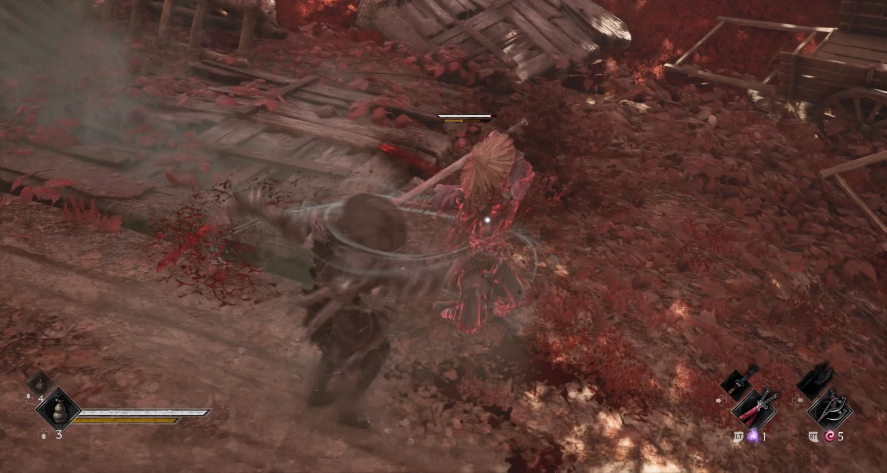
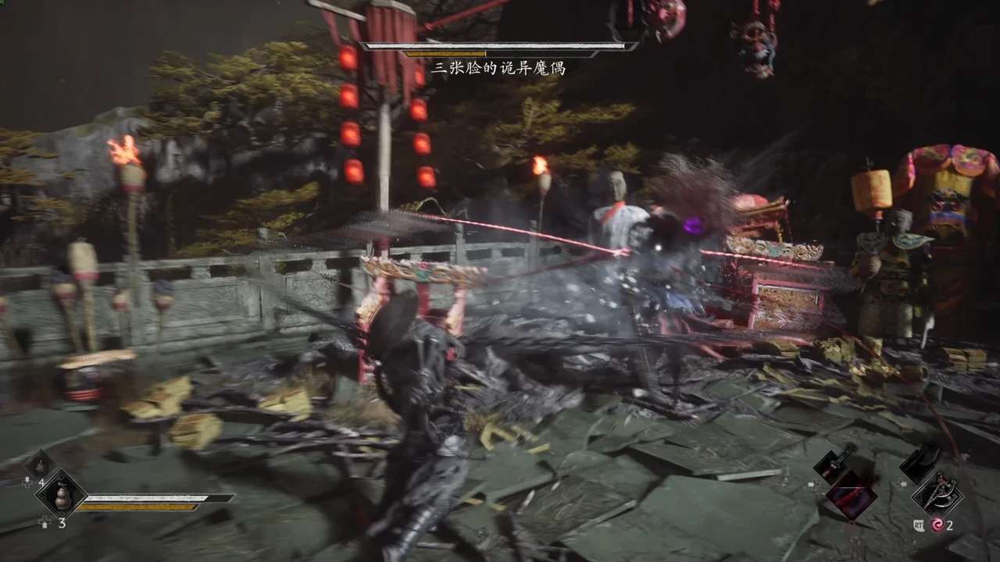
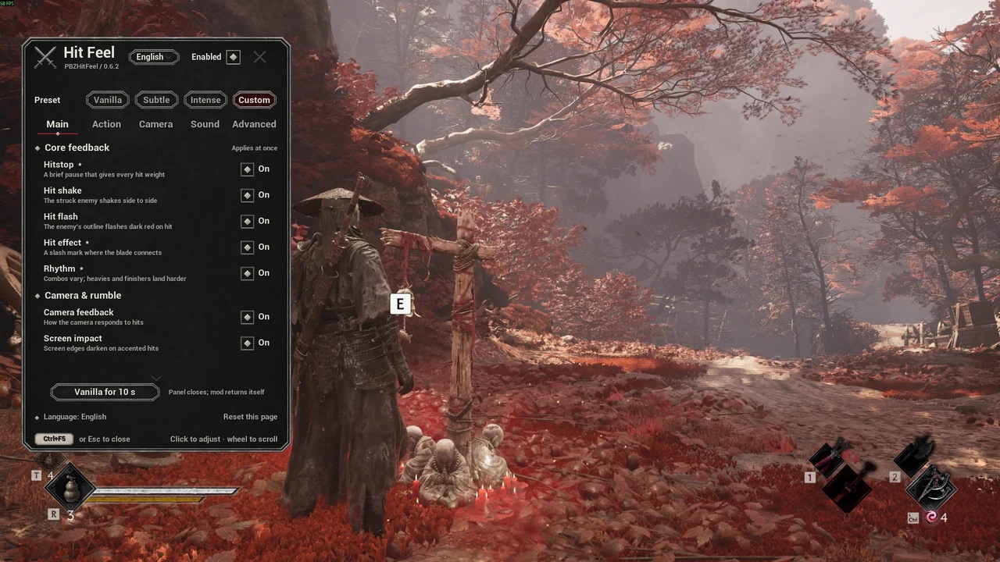
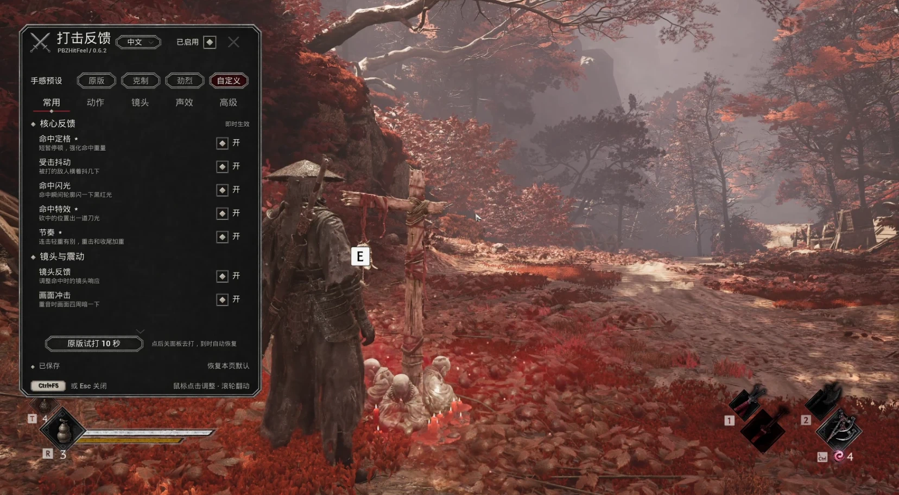

# PBZHitFeel - Hit Feel Overhaul

Adds weight to every hit: enemy-only hit stop, rim flash, camera shakes, slash effects, rumble and sound. Based on PBZHitFeel by MoonlightSakura.

**The author:** PBZHitFeel is made by **MoonlightSakura**:
[Nexus Mods profile](https://www.nexusmods.com/profile/MoonlightSakura?gameId=10614),
[the original mod page](https://www.nexusmods.com/phantombladezero/mods/473),
[bilibili](https://space.bilibili.com/en/666977). We took it over so that the mod manager (UE MM) can include it, under
the author's MIT license, which allows a reupload. This build is PBZHitFeel 0.7.3 with a crash fix and without its
in-game updater (see "Changes from PBZHitFeel 0.7.3"). All the hit feel is MoonlightSakura's work.

## What it does

A UE4SS script. It changes nothing on disk outside its own folder and does not touch your saves: everything happens
in memory while the game runs.

- **Hit stop on the enemy only:** the enemy you hit freezes for 4 to 12 frames by the strength of the blow, through
  the game's own slow-motion. You never stop on normal hits.
- **Rhythm:** quick light hits in a string land a little lighter each time; heavy hits and the hit that ends a string
  are accents with a stronger hold, shake, flash and rumble.
- **Hit flash:** a short dark-red flash on the outline of the enemy you hit.
- **Hit shake and push:** the enemy's model shakes sideways and is pushed a few cm while it is held. Only the model:
  hit boxes, AI and animations stay as they are.
- **Camera:** the game's attack shakes one level stronger, a shake on light hits the game leaves still, and a short
  push-in along the swing.
- **Screen impact:** on accents, the screen edges darken for a moment (at most once every 1.2 seconds).
- **Hit effect:** a slash mark where the blade lands, along the real swing, in front of the game's own blood and smoke.
  Ctrl+F6 cycles 13 effects.
- **Swing trail:** an air trail follows the blade through every swing.
- **Deflects:** clash sparks, a clang layer, a short stop for both sides and rumble.
- **Being hit:** the camera recoils, your model is pushed back, a red flash, a stronger hit shake.
- **Sha-Chi and guard breaks:** below half Sha-Chi in a fight the screen edges turn dark red, and below 30% they beat
  like a pulse; a guard break flashes the edges, staggers the camera and gives a heavy double rumble.
- **Kill accent:** the blow that kills an enemy holds and shakes a little more.
- **Audio:** the battle music steps back for a moment on hits; dual blades get a deeper hit sound layer.
- **Knockback ease-out:** knockbacks start faster and end slower, over the same distance.

## Screenshots

The cover and the screenshots come from PBZHitFeel's page by MoonlightSakura. The panel shots show PBZHitFeel 0.6.2.

## How to install

1. Install UE4SS for Phantom Blade Zero, for example [UE4SS](https://github.com/KintaroModding/ue4ss) (its zip
   `phantombladezero_ue4ss_<version>.zip`: the official UE4SS build with a config that makes it run in this game).
2. If you have the original PBZHitFeel, remove its folder `ue4ss\Mods\PBZHitFeel\` first: both would change the
   same hits. You can copy your `tuning.lua` from it into the new folder to keep your panel settings.
3. Download the zip of the latest release on GitHub (`phantombladezero_hitfeel_<version>.zip`).
4. Unpack it into the game folder `platform\steam\`, next to the game's exe. It adds the folder
   `ue4ss\Mods\phantombladezero_hitfeel\` (with the file `enabled.txt`, UE4SS starts it by itself).
5. Start the game.

To check that it runs: `platform\steam\ue4ss\UE4SS.log` has the line
`[PBZHitFeel] Hit Feel <version> (PBZHitFeel 0.7.3 without the physics jiggle) loading`.

To update the mod, copy the new release over the folder. Your panel settings (`tuning.lua`, `tuning_custom.lua`,
`slash_choice.txt`, `slash_tuning.lua`) are not in a release, so they stay. To remove it, delete the folder
`ue4ss\Mods\phantombladezero_hitfeel\`.

## How to use

Nothing to do: the mod works as soon as you are in a level. The hotkeys work in the game, not in its menus:

| Key | Action |
|---|---|
| Ctrl+F5 | Open or close the tuning panel (used with the mouse; Esc closes it too) |
| Ctrl+F6 | Next hit effect, previewed in front of you |
| Ctrl+F7 | Mod on/off for this session (rumble: one pulse = on, two = off) |
| Ctrl+F8 | Reload the settings and the scripts |
| Ctrl+F9 | Write probe data to `logs\` |

The tuning panel has feel presets (Vanilla, Subtle, Intense, Custom), five tabs (Main, Action, Camera, Sound,
Advanced) and a description on every row. Changes apply at once. "Vanilla for 10 s" turns the mod off for 10 seconds
so you can compare. The panel is in English, Chinese, Japanese and Korean and follows the game's language by default.

## Settings

The panel saves its values in `tuning.lua` in the mod folder; they override `config.lua`. Delete `tuning.lua` to go
back to the file's values.

Every setting is also in `platform\steam\ue4ss\Mods\phantombladezero_hitfeel\config.lua`, with a comment on each line:
the hit stop, deflects, audio, camera, screen impact, rhythm, kill accent, effects, hit reaction, rumble, knockback,
flash, being hit, Sha-Chi and guard breaks, the panel and the hotkeys. Open it with a text editor, change a value,
save, and press Ctrl+F8 in the game. A setting the file does not have keeps its default.

## Compatibility

- Game version: Steam build 26367565 (`CL-302256_JKS-17280`).
- Tested with UE4SS `v4.0.0`.
- The original PBZHitFeel: remove it first (install step 2). Other hit stop mods change the same hit lookup: do not
  combine them, or turn off the hit stop in one of them.
- Other mods that use Ctrl+F5 to Ctrl+F9 clash with the hotkeys; `Keys` in `config.lua` moves them.
- PBZModLoader can run beside it. Keep its Alt+F5 free: do not move this mod's keys to Alt+F5.
- Mods that slow the game's time on dodges and parries, such as
  [Witch Time](https://github.com/KintaroModding/phantombladezero_witchtime): not tested together.

## Known issues

- Frame rate in fights: the game's own frame rate drops in fights too. `logs\hitfeel.log` has a `perf` line every
  minute of fighting with the mod's own share; Ctrl+F7 compares the same fight with the mod off.
- If the game crashes with this mod, send `ue4ss\UE4SS.log` and `ue4ss\Mods\phantombladezero_hitfeel\logs\recent.txt`
  (the mod's last actions; after a restart it is `recent.prev.txt`).

## Changes from PBZHitFeel 0.7.3

- **The physics jiggle is removed.** It turned physics on for the bones of an enemy in the middle of its hit animation.
  A player's crash in the game's animation code points to it, and the original had it off by default.
- **The in-game updater is removed.** It checked Nexus Mods for the original PBZHitFeel and installed it over the mod's
  folder, which would bring back what this build removes. Updates come as new releases here.
- The comments in `config.lua` and the manual (`README.md` in the mod folder) are in English.
- The log names this build: `Hit Feel <version> (PBZHitFeel 0.7.3 ...)`.

## How to build

There is nothing to build: `src\phantombladezero_hitfeel\` is the mod folder (`Scripts\main.lua` starts it).
`tests\test_main.py` checks the scripts outside the game with Lua 5.4 ([lupa](https://pypi.org/project/lupa/)):
`python tests\test_main.py`. `README.md` has the details.

## Credits

PBZHitFeel is made by MoonlightSakura:
[Nexus Mods profile](https://www.nexusmods.com/profile/MoonlightSakura?gameId=10614),
[the original mod page](https://www.nexusmods.com/phantombladezero/mods/473),
[bilibili](https://space.bilibili.com/en/666977). MIT license, code and panel art; the mod folder keeps the author's
`LICENSE`. We took it over so that the mod manager (UE MM) can include it; the changes by Kintaro are under the same
MIT license. UE4SS is made by the [UE4SS-RE team](https://github.com/UE4SS-RE/RE-UE4SS). Phantom Blade Zero belongs to
its makers.
